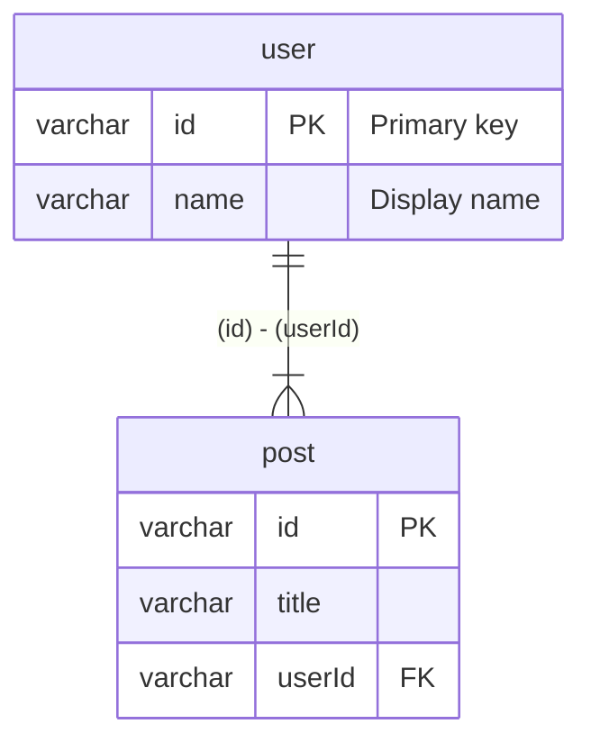

# Sizuku

**[Sizuku](https://www.npmjs.com/package/sizuku)** reads a [Drizzle](https://orm.drizzle.team/) schema — with the comments you already write as its descriptions — into ER diagrams and DBML, and opens it in a local studio.

## Features

- 📊 Creates [Mermaid](https://mermaid.js.org/) ER diagrams
- 📝 Generates [DBML](https://dbml.dbdiagram.io/) (Database Markup Language) files
- 🖼️ Draws ER diagrams as **SVG** / **PNG** images (light and dark)
- 💬 Describes tables and columns from plain TypeScript comments (`/** … */` or `//`), nothing sizuku-specific
- ✏️ `sizuku studio`: edit the schema in Monaco beside its live ER diagram, read its generated docs, run Drizzle queries and SQL, and browse and edit the database's rows
- 🌱 `sizuku seed`: fill the database with rows from [faker](https://fakerjs.dev/) or your own, typed against the schema and keeping every foreign key and unique key

## Installation

```bash
npm install -D sizuku
```

## Usage

```
sizuku <input> -o <output> [options]
sizuku studio <input> [--port <port>] [--url <database-url>]
sizuku seed [--config <path>] [--url <database-url>] [--sql <file>] [--seed <n>] [--count <n>] [--locale <locale>] [--reset]
```

The flags can come before or after the input. A command line that cannot run (a missing `-o`,
an unknown format, a file that is not there) prints why and exits with code 1.

### Options

```
-o, --output <path>               Output file path (.md, .dbml, .svg, .png)
--theme <light|dark>              Colour scheme of the .svg / .png ER diagram
-p, --port <port>                 Port for sizuku studio (default: 4983)
-u, --url <database-url>          Database for sizuku studio (default: $DATABASE_URL)
-h, --help                        Display help message (sizuku studio --help, sizuku seed --help)
-v, --version                     Print the version
```

### Quick Start

```sh
# Generate DBML
npx sizuku db/schema.ts -o docs/schema.dbml

# Generate ER diagram (SVG or PNG)
npx sizuku db/schema.ts -o docs/er.svg
npx sizuku db/schema.ts -o docs/er.png --theme dark

# Generate Mermaid ER diagram
npx sizuku db/schema.ts -o docs/ER.md

# Edit the schema, its ER diagram, docs and data in the browser
npx sizuku studio db/schema.ts --url file:./dev.db

# Fill the database with the rows sizuku.config.ts describes
npx sizuku seed
```

## Comments

A comment written directly above a table, a column or an enum is its description — in the DBML
notes, the Mermaid diagram, the ER diagram's cards and the studio's docs. Any TypeScript comment
will do: a JSDoc block, a block comment, or `//` lines.

```ts
/** Everyone who can sign in */
export const user = mysqlTable("user", {
  /** Primary key */
  id: varchar("id", { length: 36 }).primaryKey(),
  // Display name
  name: varchar("name", { length: 50 }).notNull(),
});
```

- The lines of a comment, or of a run of `//` lines, are joined into one description.
- A comment that ends a line of code (`id: int(), // ...`) belongs to that line, and one
  separated by a blank line (a file header) describes nothing.
- Lines starting with `@` are tags (`@deprecated`, ...), not description.

## Output Examples

### DBML

```sh
npx sizuku db/schema.ts -o docs/schema.dbml
```

```dbml
Table user {
  id varchar [pk, note: 'Primary key']
  name varchar [note: 'Display name']
  Note: 'Everyone who can sign in'
}

Table post {
  id varchar [pk]
  title varchar
  userId varchar
}

Ref post_userId_user_id_fk: post.userId > user.id
```

### Mermaid ER

```sh
npx sizuku db/schema.ts -o docs/ER.md
```



### ER Diagram (SVG / PNG)

```sh
npx sizuku db/schema.ts -o docs/er.svg
npx sizuku db/schema.ts -o docs/er.png --theme dark
```


Tables are laid out left to right along their relations. Each card shows its columns with
the primary key, foreign keys, `UK` for unique columns, `?` for nullable ones, defaults
(`.default()`, `.defaultNow()`, `$defaultFn()`, `$onUpdate()`), the comments' descriptions and the
indexes, unique and composite key constraints of the table. `pgEnum`s get a card of their own.
Edges use crow's-foot notation and name the relation and its `onDelete` / `onUpdate` action;
an edge declared only by a `relations()` block is dashed, since nothing in the database backs it.

## Studio

```sh
npx sizuku studio db/schema.ts
npx sizuku studio db/schema.ts --url file:./dev.db          # SQLite (node:sqlite)
npx sizuku studio db/schema.ts --url postgres://localhost/app # pg from your project
```

Opens `http://127.0.0.1:4983` with these pages:

- **Schema**: the saved schema's ER diagram across the page, as draggable cards.
- **Drizzle schema**: the file in Monaco with the diagram beside it, redrawn as you
  type; the table under the cursor is selected. Completion, hovers, signature help and type errors
  come from the project's TypeScript and drizzle-orm's types; syntax errors are underlined with
  their line while the last good drawing stays. Ctrl/Cmd + S saves, **Format** runs oxfmt, and
  the diagram downloads as SVG or PNG, laid out as on the canvas.
- **Docs**: every table, column, key, default, index, relation (both ways) and enum, with the
  comments' descriptions, and Drizzle queries for each table to open in the Query page.
- **Query**: Drizzle against the database (`db.select().from(post)`,
  `db.query.post.findMany({ with: { author: true } })`), with completion, the result as a table
  or JSON, the SQL it sent, and a diagram that lights up the tables the code touches.
- **Tables and enums**: a page per table with its rows — searched, edited in place, copied,
  exported, added and deleted (composite keys included) — and its columns, relations and
  indexes; a page per enum with its values and the columns that hold it.
- **SQL**: SQL read as it is typed — its data flow, the lineage and types of its columns, its
  parameters, the problems in it and its plan — and run on the same database.

**Format** follows the project's `.oxfmtrc.json` when it has one. The server listens on
`127.0.0.1` only.

See [docs/studio.md](https://github.com/nakita628/sizuku/blob/main/packages/sizuku/docs/studio.md) for the full guide and
[docs/studio-api.md](https://github.com/nakita628/sizuku/blob/main/packages/sizuku/docs/studio-api.md) for its API.

## Seed

```sh
npx sizuku seed                 # insert into the database of the config's url, or DATABASE_URL
npx sizuku seed --sql seed.sql  # or write the rows as a SQL script
```

`sizuku.config.ts` imports the Drizzle schema module and says what to insert. `defineConfig` types
it against the schema: every table (by its export name), column, relation and bound is checked,
and a rule function knows the row it sees.

```ts
// sizuku.config.ts
import { defineConfig } from "sizuku";

import * as schema from "./db/schema";

export default defineConfig(schema, {
  url: "file:./dev.db",
  seed: 42,
  models: {
    // Rows from faker, shaped by rules
    user: {
      count: 20,
      fields: { age: { min: 18, max: 65 }, nickname: { nullRate: 0.3 } },
      relations: { posts: { min: 1, max: 3 } },
    },
    post: { count: 40 },
    // Or real rows, as they are
    tag: { data: [{ label: "drizzle" }, { label: "effect" }] },
  },
});
```

A model is seeded from faker (`count`, `fields`) or from real rows (`data`), not both. In a real
row no id is written by hand:

- a column left out takes its default (`.default()`, `$defaultFn()`, the next number of a serial or
  autoincrement), and one with a SQL default (`` sql`CURRENT_TIMESTAMP` ``) is left to the database;
- a `many()` relation nests the child rows, whose key to the parent is filled in
  (`posts: [{ title: "Hello" }]`);
- a `one()` relation names the parent by a unique key (`author: { email: "ann@example.com" }`);
  left out, a required one is linked to a row that exists.

`defineData(schema, "user", [...])` types rows kept in their own file.

The tables are filled parents first, and every foreign key, unique key, enum, length and
nullability is respected; a relation that only a `relations()` block declares is filled like a
foreign key. Every row is checked against its columns before anything is written, and the rows
go in one transaction (on PostgreSQL, the sequences are moved past them). The seeder fills tables
that exist; create them first, with drizzle-kit or your migrations.

| Option                     | What it does                                                                                                                        |
| -------------------------- | ----------------------------------------------------------------------------------------------------------------------------------- |
| `seed`                     | The faker seed: the same seed gives the same rows                                                                                   |
| `locale`                   | The faker locale, or several tried in order (`["ja", "en"]`)                                                                        |
| `count`                    | Rows for every table without a rule of its own                                                                                      |
| `nullRate`                 | How often a nullable column is null, from 0 to 1                                                                                    |
| `dates`                    | The window every date falls in (`{ from, to }`)                                                                                     |
| `url`                      | The database (`file:./dev.db`, `postgres://...`, `mysql://...`)                                                                     |
| `output`                   | Write SQL to this file instead of inserting                                                                                         |
| `reset`                    | Delete every row of the seeded tables first                                                                                         |
| `models.<table>.fields`    | Per column: a function `(faker, { index, row }) => value`, or `value`, `values`, `min` / `max`, `from` / `to`, `length`, `nullRate` |
| `models.<table>.relations` | Per `many()` relation: how many children each row has (`min` / `max`)                                                               |

The command line overrides the config: `--url`, `--sql <file>`, `--seed <n>`, `--count <n>`,
`--locale ja,en`, `--reset` and `--config <path>`. SQLite is written through `node:sqlite`,
PostgreSQL through `pg` and MySQL through `mysql2`, as installed in your project.

## Relation Detection

Sizuku detects relations from three sources. They are reflected consistently
across every ER output format (Mermaid, DBML, SVG and PNG).

### 1. `.references()` chain

```ts
userId: varchar("user_id").references(() => user.id);
```

### 2. `foreignKey()` constraint

```ts
export const post = pgTable('post', { ... }, (t) => [
  foreignKey({ columns: [t.userId], foreignColumns: [user.id] }),
])
```

The older object form, `(t) => ({ fk: foreignKey(...) })`, is read as well.

### 3. `relations()` block (no foreign key required)

```ts
export const post = pgTable("post", {
  id: uuid("id").primaryKey(),
  userId: uuid("user_id").notNull(), // no .references()
});

export const postRelations = relations(post, ({ one }) => ({
  user: one(user, { fields: [post.userId], references: [user.id] }),
}));
```

Drizzle's `relations()` are not database constraints, so a `one()` with `fields` and `references`
is drawn even when no foreign key backs it. Such an edge is dashed; when a `.references()` or
`foreignKey()` backs the same pair, it is drawn solid as that foreign key. The child side is
"one or more" when its column is `.notNull()`, else "zero or more". `many()` adds nothing on its
own, since it names no columns.

## License

Distributed under the MIT License. See [LICENSE](https://github.com/nakita628/sizuku?tab=MIT-1-ov-file) for more information.
