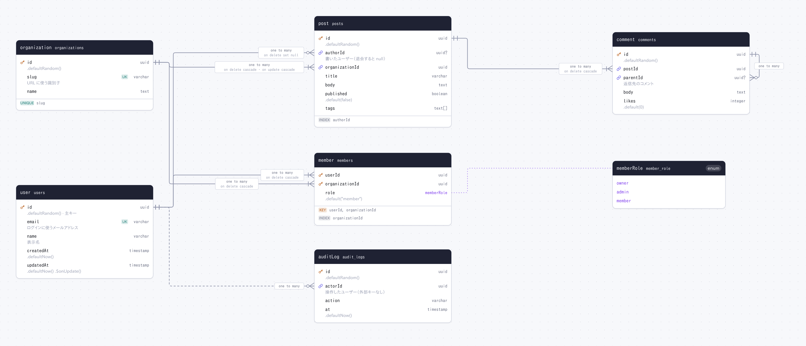

# sizuku studio example

A Drizzle (PostgreSQL) schema to try `sizuku studio` and the ER diagram on. It uses everything the
diagram draws: a `pgEnum`, a composite primary key, unique and plain indexes, `foreignKey()` and
`.references()` with `onDelete` / `onUpdate`, a self reference (comment replies), an array column,
defaults, `///` descriptions in Japanese, and a relation declared only by `/// @relation`
(drawn dashed).

## Try the studio

From the repository root:

```sh
pnpm install
pnpm studio
```

This builds sizuku and opens the editor on [db/schema.ts](db/schema.ts) at
<http://127.0.0.1:4983>. In a Dev Container or Codespace, open the forwarded port 4983 from the
**Ports** tab. Stop the server with Ctrl+C.

- Edit the schema on the left; the diagram on the right redraws as you type.
- **Ctrl/Cmd + S** saves to `db/schema.ts`. Put it back with `pnpm -F @examples/studio reset`.
- Drag to pan, scroll to zoom, **Fit** to see it all; **Theme**, **Export SVG** / **Export PNG**.

To run it from this directory on another port: `pnpm studio -- --port 5000`.

## Generate the files

```sh
pnpm example   # from the repository root
```

writes [docs/](docs) from the schema: `er.svg`, `er.png`, `er-dark.png`, `ER.md` (Mermaid) and
`schema.dbml`.


